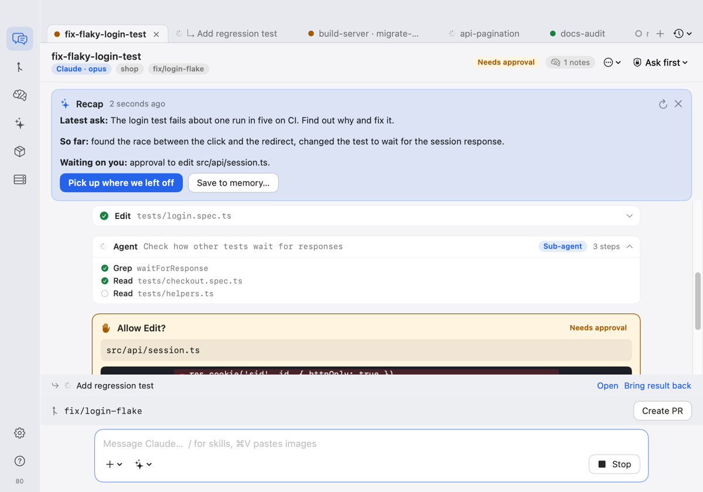
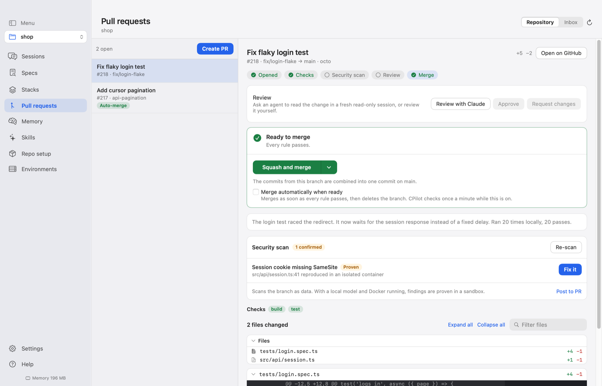
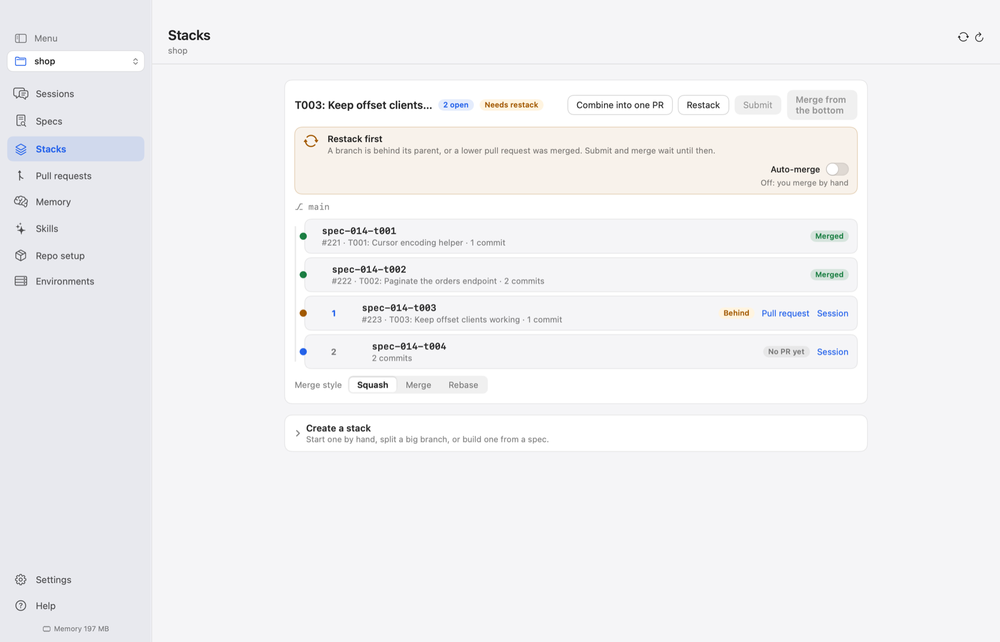
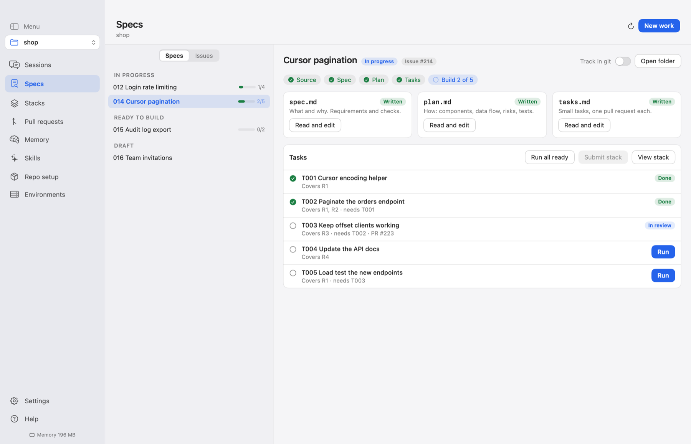
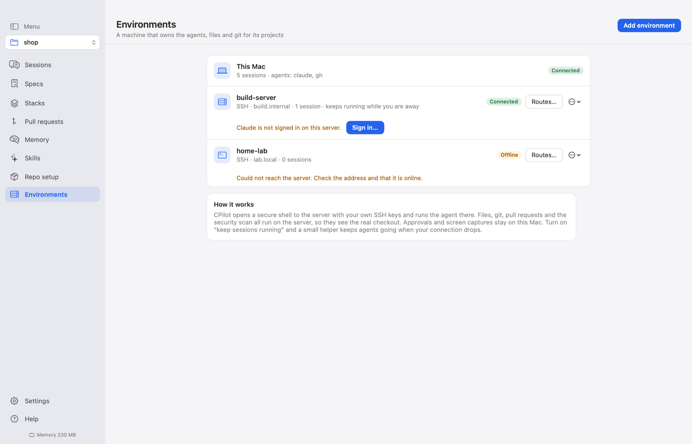
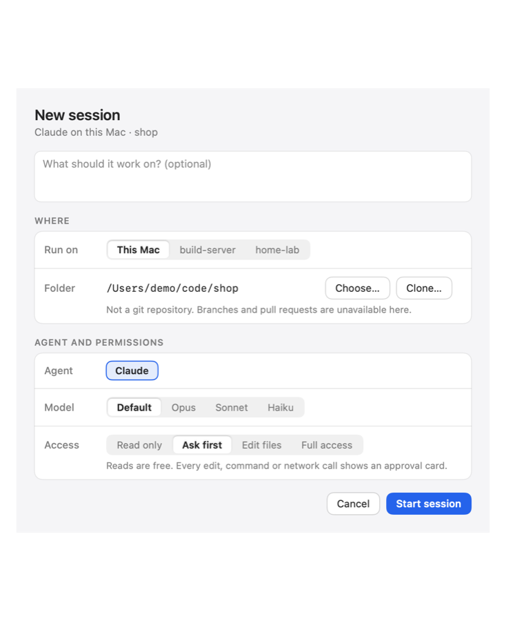
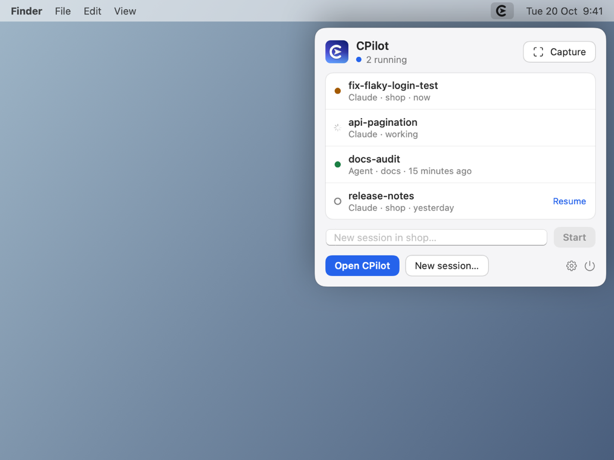

# CPilot

A superlight native macOS app for running AI coding sessions from your menu bar. Tabs for many sessions, one calm chat, approvals you control, and pull requests from branch to merge.

<p align="center"></p>

## Install with an AI agent

Paste this into an AI coding agent such as Claude Code. CPilot detects and installs its own prerequisites on first launch, so the agent does not have to:

```text
Install CPilot on this Mac.
1. Run: curl -fsSL https://raw.githubusercontent.com/kalahroudi/cpilot/main/scripts/install.sh | bash
2. CPilot opens and its first-run setup checks what it needs and installs whatever is missing. Tell me to click
   "Set everything up" in that window if it is waiting, and wait until it reports everything is ready.
   If a step needs my password, tell me exactly which command to run in Terminal.
3. Register its MCP server: claude mcp add cpilot --scope user -- /Applications/CPilot.app/Contents/MacOS/cpilot-mcp
4. Call get_status and tell me what it reports.
Never call a destructive tool without asking me first.
```

Or by hand: download the latest disk image from [Releases](https://github.com/kalahroudi/cpilot/releases), or run the install script above.

## What it does

**Sessions**

- **Many sessions, one pane.** Sessions are tabs or a side list, for the repository chosen in one switcher at the top of the menu. Only the open tab has a live view; idle tabs stop their agent and resume later with full context. Option-Command-N starts a quick session: Claude on Sonnet in its own worktree on a new branch. The mouse's back and forward buttons, a two-finger swipe and Command-[ and Command-] retrace the panes and sessions you visited.
- **One calm chat.** Replies stream as Markdown with highlighted code, sub-agent runs nested under the step that started them, and edit previews as diffs. Drop files or images anywhere to attach them. Messages you send while the agent works are queued and go out when the turn ends. After each turn Claude drafts your likely next message, faint in the box; Tab fills it in. Open a session you left and a recap says where things stand.
- **Run what the agent tells you to run.** Commands in a reply become Run chips that open an integrated terminal in the session's worktree (or Ghostty). Pages, SVGs, PDFs and images the agent writes can be rendered in the app, and every file a session wrote or changed is listed with a preview, its changes and a way to show it in Finder.
- **Claude and other agents.** Claude runs through its headless command line. Any agent that speaks the [Agent Client Protocol](https://agentclientprotocol.com) can be added from the official registry in one click, including Antigravity, Cursor, goose, OpenCode and DeepSeek. Test on each agent reports whether it works, needs sign-in or what failed.
- **Access you control.** Read only, Ask first, Edit files or Full access, with per-project rules. Every action that needs approval shows a card with a short headline ("Edited Package.swift") and the details behind it: allow once, for the session, or always in this project. Full access needs Touch ID. Every decision is logged.
- **Nothing lost on a crash.** Messages are written to disk as they complete, streaming replies are checkpointed, drafts are saved as you type, and sessions resume by id with the agent's own context.
- **Capture.** Press Control-Option-Command-C to grab part of the screen, or add selected text, the front browser page or the clipboard. It lands in the active session's composer.

**Shipping**

- **Pull requests, end to end.** Create (CPilot brings the branch up to date with its base first, or hands conflicts to the agent), read the diff and commits, review with an agent, run a security scan, and merge with a box that works like GitHub's: merge styles, a bypass when rules allow it, a refusal if the branch moved, and a warning when the base already has the same change. Merge automatically when your rules pass. Open pull requests refresh while you watch, you are notified when checks pass or fail or a pull request starts conflicting, and an inbox lists every pull request that needs you. Everything goes through your own GitHub login.
- **Stacks.** Split a big change into small pull requests that build on each other. CPilot restacks when something changes underneath (including after a squash merge), submits the chain with the right bases, merges from the bottom, and offers an agent for conflicts. An agent can propose how to split a large branch. When pull requests in a stack edit the same files, one button combines them into a single pull request: Claude merges the pieces, removes duplicated code, checks it builds and passes, and CPilot opens the new pull request and closes the old ones. It uses plain git and the GitHub CLI.
- **Specs.** Start from a GitHub issue, a rough requirement you type, a conversation, existing code, a capture or an existing spec folder. A read-only agent drafts `spec.md`, `plan.md` and `tasks.md`; you approve each document, or let it run on its own and carry on after a restart. Each task then runs as a session on its own branch, stacked on the tasks it needs, and ticks itself off when its pull request merges. Specs live in a hidden `.cpilot` folder unless you choose to track them in git, and finished ones are archived.
- **Repo setup in one go.** README, license, GitHub Pages, a protected main branch and a scan on every pull request.

**Anywhere**

- **Servers.** Add a machine over SSH (keys, ssh config, Tailscale or a password in the Keychain) and run sessions there, with its files, git and pull requests. CPilot sets the server up: Claude, Node.js and every connected agent, on Linux including Raspberry Pi. Sign in to Claude or an agent from CPilot. Turn on "keep sessions running" and a small helper (one Node.js file, no network port) keeps agents working when your connection drops, then catches you up when you reconnect. Several addresses per server are tried in order. Approvals and captures stay on your Mac, and Full access is not offered on servers.
- **Memory that recalls.** Plain Markdown notes every session starts with, plus a local index (full-text and on-device meaning search, one SQLite file) of your finished messages. A new session starts with the best matches from earlier work. Fork a session or hand it to another agent with a summary, save what a session learned as a note in one click, and see exactly which notes a session loaded. An optional long-term memory engine can also connect over MCP. Every note keeps its history (who changed it, when and why, with restore and undo-delete), and a save that was based on an old version is refused instead of overwriting what someone else wrote, so the app, finished runs and agents never work against each other. Notes written by agents and runs on their own are checked first: no secrets, no commands that fetch and run code, no instructions to the agent, no way around the checks, and no wiping a note.
- **Skills.** Skills found on your Mac are listed and one click away in the composer. Create one with Claude, or add to an existing one from a note or a session.
- **Chief pilot.** One session per repository, opened from Specs, that you give an outcome to. It writes the spec (and asks you its open questions), plans it, starts the tasks as sessions on stacked branches, watches them, restacks, and takes the stack to pull requests and merges (it can also merge a pull request that is not part of a stack, by number), by calling CPilot's own tools, and carries on by itself: when the tasks or reviewers it started finish, CPilot wakes it to take the next step. It never edits files or runs commands itself, only reads. By default it leads on its own and pushes and merges without asking; a setting makes it ask before each push and merge. Every pull request gets a reviewer session that reviews the diff, fixes its findings and pushes them to the pull request's branch; the chief pilot reads each report and sends a reviewer back (or starts a fresh one) until nothing is left open, and nothing merges until a reviewer has finished, or past failing checks, or as an administrator.
- **Control it from your phone.** Turn on Remote in Settings and CPilot publishes a small page on your tailnet over HTTPS (through Tailscale; nothing is open to the internet). Pair a phone with a QR code, then see every session grouped by what needs you, start new ones in their own worktree, message or stop them, talk to the chief pilot, and answer approvals. Turn on alerts and the phone is told when something needs it, a session or trigger fails, or a run it started finishes, straight from the Mac to the phone's push service and encrypted so only that phone can read it. A phone can start sessions with at most Edit files and cannot turn on Full access; pushing and merging can be approved from a phone only if you allow that for it. Every remote action is in the audit log, which keeps 90 days.
- **Learns from finished runs.** When a chief pilot run is over, CPilot reads what its reviewers caught and what failed, asks Claude once (small model, no tools) for the few lessons worth keeping, and adds them to a note for that repository. Every later session there starts with it. A run with nothing to learn from makes no call, and lessons with a link, a secret or anything that reads like an instruction are thrown away. Edit or delete the note in Memory, or turn it off in Settings.
- **Dreams.** After a few sessions in a repository have finished, CPilot asks Claude once (no tools) to look over what they did and propose changes that keep that repository's notes true: add what was learned, fix what is out of date, merge duplicates, remove what no longer holds. Every proposal must quote the sessions word for word (a quote that is not really there is thrown away) and is checked by the same rules as every automated write. Notes you wrote only change when you approve; the rest can change on their own if you allow it, and every change has Undo. Each proposal reads the same way: what, why it matters, what CPilot recommends, and what each answer does. Turn it off, change the model, or run it now in Settings.
- **Limits on unattended work.** Triggers and the tasks and reviewers the chief pilot starts wait while a set number of agents are working (4 by default) or once a daily budget you choose is spent. Sessions you start yourself are never held. Settings shows what was spent today, this week and this month, by who started the work and how long it ran.
- **Cleans up delivered work.** When the pull request of a task or reviewer that the chief pilot (or a trigger) started is merged or closed, CPilot removes its checkout, deletes a reviewer's scratch branch, and puts the session away; put-away sessions are deleted after 30 days (7, 30, 90 or never, in Settings, Cleanup). A session with no pull request is treated the same after two weeks idle. It runs a minute after CPilot opens, every six hours and when a chief pilot run ends, and Settings shows what it did and why it left the rest. It never touches a session you started, one that is working or was used in the last hour, one whose pull request is still open, or a checkout with changes that are not committed or commits that are on no remote and not in the pull request. Folders in CPilot's worktrees folder that no session or repository owns are removed after a week. Everything it does is in the audit log.
- **Hands over commands per worktree.** When a step needs you at the command line (approving protected-file changes, resolving a conflict), the chief pilot looks at each task's worktree with a read-only tool (what is staged and changed there, its last commit, and the scripts that exist there from `package.json`, `Makefile` and `justfile`) and lists the exact commands under each task as `cd <worktree> && <command>`. Each becomes a button in the chat that runs in that worktree, so you never go looking for them. Only this repository's own folders are accepted, so a message cannot aim a button elsewhere. A command that is not offered is never guessed: the chief takes script names from the worktree, not from memory.
- **Context Lens.** Where your usage goes, read from the transcripts Claude Code already writes on this Mac (nothing is sent anywhere, and only sizes and names are kept, never what was said). Each session's header shows how large its context is and how much of it came from the cache; a pane lists every session of the last day, week or month with calls, peak context, cache hit, what the same tokens would cost on the API and, opened up, the pauses that let the cache expire and the tools whose results were largest. A context past 200k tokens is marked, because every call after that re-reads all of it: a banner offers **Continue lean**, a new session started from a summary instead of the whole conversation, and warns when a pause has let the cache expire and says what the next message will write again. The pane also splits usage by who started it (you, the chief pilot, reviewers, testers, spec tasks, or Claude Code outside CPilot), and a read-only `usage_report` MCP tool lets the chief pilot and agents see the same numbers. The first launch reads the last 90 days, newest first; after that it reads only what is new. [The plan](docs/CONTEXT_LENS.md) covers what comes next: alerts, forking a bloated session, gating tool output, and before-and-after numbers for each change.
- **Approvals in one place.** When a repository's guard holds a commit until a person approves it (for example `pnpm guard:approve`), every worktree waiting on that, across all sessions and repositories, is listed in one pane: the task, the staged files and their diffs. Open the diff, check the commit message, and one button runs the repository's own approval in that worktree, stages the lock file it writes, commits and tells the session to carry on. Approval stays a person's act: the button is off until the diff has been opened, and "approve reviewed" in bulk covers only the ones you opened.
- **Usage limits.** When Claude says "You've hit your session limit · resets 2am (Europe/London)", CPilot reads the reset time (its own time zone, a weekday or date, or the older epoch form), shows it in a banner in every session, and holds everything that starts by itself: the chief pilot's wake-ups, gate retries, triggers and new tasks wait instead of asking again and again. The messages it would have sent are kept. A minute after the reset the chief pilot and CPilot's own workers carry on by themselves; your own sessions are never held, and are listed in a notification so you can continue them. "Carry on now" is on the banner for a limit that lifted early. It survives a restart and a sleeping Mac.
- **Models.** Every session shows the model it is really running (what "Default" turned out to be) and can switch at any time from its header; the agent restarts on the same conversation, and one that is working finishes its turn first. The picker lists what Claude Code itself says your account can use, read from its own model catalog, so a new model such as Fable 5.2 appears as soon as Claude Code knows it, older ones sit under "Older models", and any id can be typed.
- **Scheduling.** Triggers can run once at a chosen time as well as on a repeat, and **Schedule a message…** in a session's menu sends that session a message later ("carry on at 2am", or when the usage limit resets), in the same conversation. Scheduled work waits for a usage limit and runs late, once, if the Mac was off or asleep at the time.
- **Checked before review.** When a task's session says it is done, CPilot runs the task's `verify:` command (or the repository's own, one per line in `.cpilot/verify`) in its worktree, and checks the diff for tests that lost assertions, were deleted or switched off, and for a task that never touched the files it names. Whatever fails goes back to the session by itself, with the output. The same failure three times in a row, or fifteen tries, stops it and tells you; a stopped task is not submitted. What the check has seen of each task, and the commit it passed on, is kept across restarts, so a restart neither forgets a stopped task nor checks an unchanged one again. No model is involved in this step.
- **Tests first** (Settings, Specs and stacks; off by default). The same session writing the code and the tests can misread the spec twice and pass its own checks. With this on, a task that needs it (every task, or the risky ones: security, money, deletion, migrations, permissions) gets a separate **tester** first. The tester sees the spec's requirements and the repository's rules, never the plan or the code, and writes tests that fail now, including hostile input, every setting, and fuzz or property tests where the language has them. CPilot checks that every requirement and rule has a named test, that only test files changed, and that the tests really fail for a missing behavior (a test that passes with no code checks nothing). It then **locks** them: the implementer cannot edit, delete, skip or weaken them, and the gate puts the tester's own copy back before it runs anything. About a third of the tests can be **held back** in a place no branch reaches; only the gate runs them, and a failure names the requirement, never the test, so the code cannot be fitted to them. If the implementer is sure a test contradicts the spec it says so, and the tester rules on it from the spec; after two rulings you decide. A **second tester** on another model can write the held-back set on its own; where the two expect different behavior the spec is ambiguous, and you are asked before any code exists. After the code passes, **mutation testing** (below) checks that the tests can fail at all, and the tester adds tests for what survives. Reviewers become **adversarial**: they attack the change from the spec and the rules, do not fix, and count a finding only with a failing test or a reproduction. Before any tests are written an independent **spec review** looks for ambiguity, missing cases and abuse cases; you approve the spec with the reasons in plain words, or it goes on by itself when the review finds nothing. A weekly review of the main branch against the rules can be added with one button. Every decision CPilot needs from you is one card: what, why it matters, what it recommends, and what each answer does. Cards show in Specs (and Memory, for dreams) and on the phone; a phone may decline, and may approve only if allowed to approve pushes.
  - `.cpilot/invariants`: the rules that must always hold, one per line starting with `-` (for example `- No request leaves the configured origin.`). Read from the repository's own checkout, never from a task's branch.
  - `.cpilot/mutation`: your mutation tool, as `command:` (with `{files}` for the changed source files), optional `report:` (a mutation-testing JSON report, which Stryker and others write), `threshold:` (default 70) and `timeout:`. For example `command: npx stryker run --mutate {files}` with `report: reports/mutation/mutation.json`. Without a report CPilot reads a `Mutation score: NN%` line, then the exit code. CPilot bundles no tool: it runs yours. Without the file, this step is skipped.
  - What this cannot do: tests come from the spec, so a wrong spec locks in wrong tests (the spec review and your approval are the defence), and nothing here finds a kind of bug nobody has thought of. The independent reviewers and the weekly review look for those, and they report what they could not prove.
- **Hard limits for unattended work.** Tasks, reviewers and triggers cannot edit CI workflows, secrets (`.env`), lockfiles, git's own files or CPilot's own files, force-push, remove folders other than build output, pipe a download into a shell, fetch from hosts other than package registries and GitHub, or change the machine's settings, whatever their access level, Full access included. The agent is told why, so it takes another route. A dependency bump can be let through with `guardExceptions` in the policy file.
- **A reviewer that ends with a verdict.** Reviewers finish with `VERDICT: CLEAN` or `VERDICT: OPEN` and the issues left; the chief pilot reads it and a pull request does not merge while it is open. Settings can give reviewers a different model from the one that wrote the code.
- **Triggers.** Work that starts by itself while CPilot runs: on a schedule (every few hours, daily, weekdays, weekly), when an issue you wrote gets a label, or when one of your own pull requests fails its checks. Each one starts the repository's chief pilot or one session on its own branch. At most six runs an hour, an issue only counts if you wrote it, a failing pull request gets two fix attempts, and everything goes through the usual rules for push, merge and access. Set them up in Settings, Triggers, and run any of them now.
- **MCP built in.** Other tools can list sessions, read results, search memory, read specs, stacks and pull requests, and start sessions (you approve each one).
- **Light and safe to run.** The menu bar popover shows what needs you. Errors open a sheet with details to copy, and an opt-in issue report with names, paths and emails removed. It checks GitHub Releases once a day and rolls back by itself if a new version fails to start.

<p align="center">
  
  
</p>
<p align="center">
  
  
</p>
<p align="center">
  
  
</p>

## Roadmap

What we want to build next is in [ROADMAP.md](ROADMAP.md).

## Requirements

macOS 15 or later on Apple silicon. First launch checks for Git and the Claude command line and offers to install the optional GitHub command line and Node.js. For servers: SSH access with a key, and the agents installed there (Node.js 18 or newer only if you want sessions to keep running while you are away).

## Build from source

```sh
swift build && swift test
scripts/bundle.sh                         # builds dist/CPilot.app
dist/CPilot.app/Contents/MacOS/CPilot --self-test
```

The core lives in `Sources/CPilotKit` (no UI, unit tested), the app in `Sources/CPilot`, and the MCP server in `Sources/cpilot-mcp`. One dependency, used only to render Markdown and highlight code in the chat. Set `CPILOT_LIVE=1` to also run the tests that talk to the real Claude command line (sessions, resume, approvals, forks, a server-held agent that survives a dropped connection, and a requirement turned into a spec, plan and tasks). `CPILOT_DATA_DIR=/tmp/cpilot-demo CPilot --snapshot <dir>` renders the screenshots in `docs/assets` from made-up data, never yours. `CPilot --bench` opens and closes the window and popover ten times and reports memory and idle CPU.

## Where your data lives

Everything CPilot owns is under `~/Library/Application Support/CPilot/`: sessions, notes, the recall index (`memory.db`), the approval log and settings. Nothing is sent anywhere; secrets such as API keys are removed before text is indexed. Delete that folder to uninstall completely.

## License

Apache License 2.0
