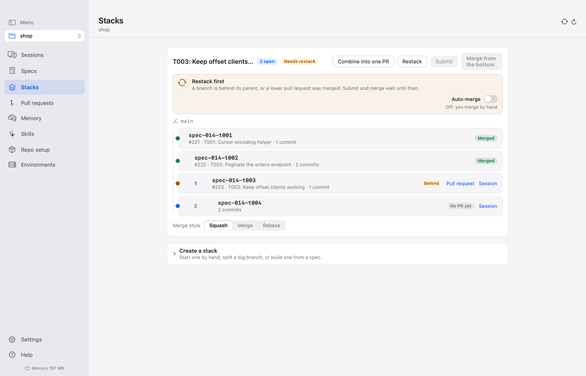
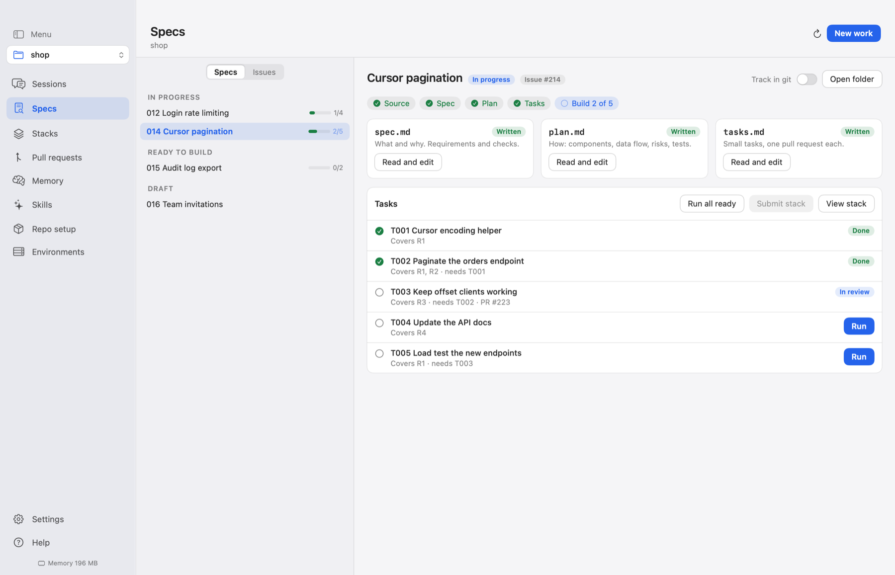
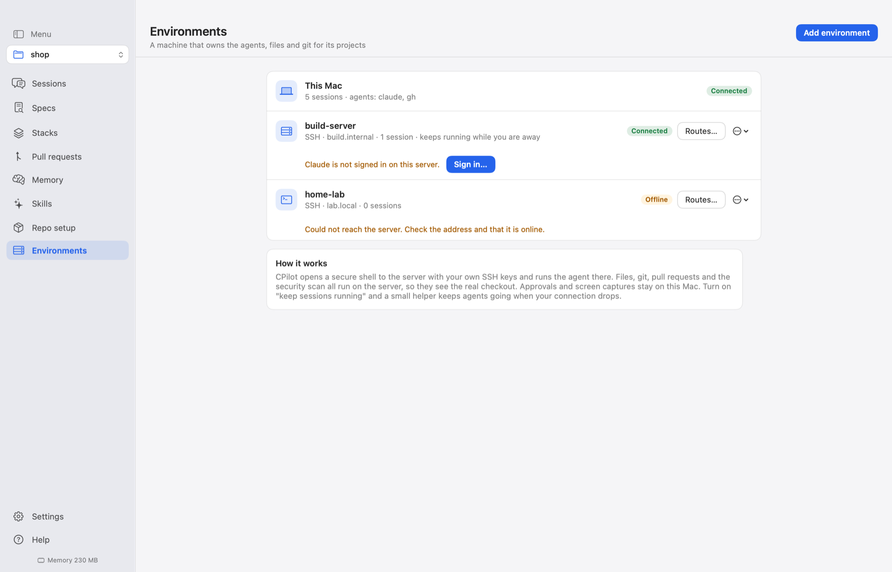
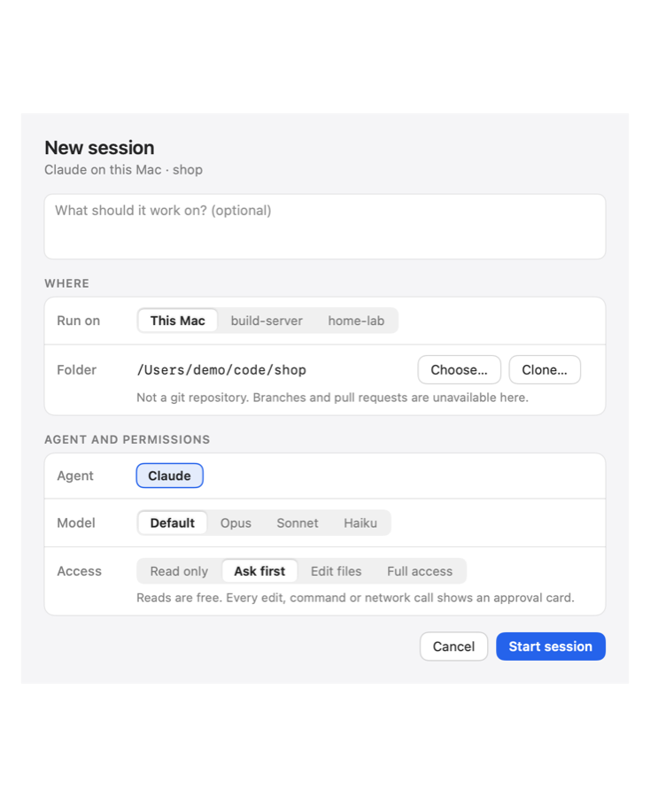
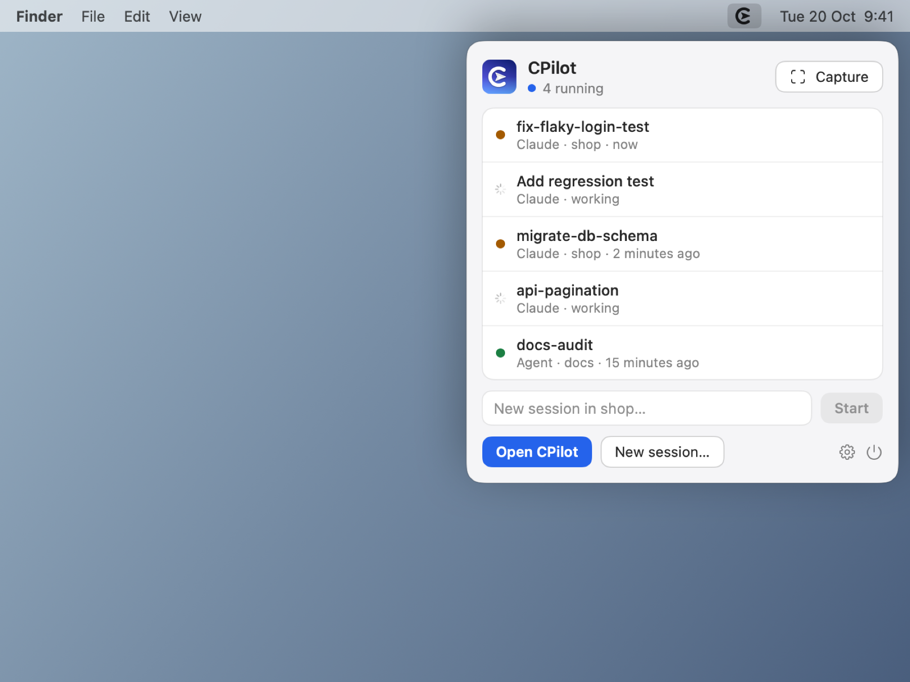

# CPilot

A superlight native macOS app for running AI coding sessions from your menu bar. Tabs for many sessions, one calm chat, approvals you control, and pull requests from branch to merge.

<p align="center"></p>

## Install with an AI agent

Paste this into an AI coding agent such as Claude Code. CPilot detects and installs its own prerequisites on first launch, so the agent does not have to:

```text
Install CPilot on this Mac.
1. Run: curl -fsSL https://raw.githubusercontent.com/kalahroudi/cpilot/main/scripts/install.sh | bash
2. CPilot opens and its first-run setup checks what it needs and installs whatever is missing. Tell me to click
   "Set everything up" in that window if it is waiting, and wait until it reports everything is ready.
   If a step needs my password, tell me exactly which command to run in Terminal.
3. Register its MCP server: claude mcp add cpilot --scope user -- /Applications/CPilot.app/Contents/MacOS/cpilot-mcp
4. Call get_status and tell me what it reports.
Never call a destructive tool without asking me first.
```

Or by hand: download the latest disk image from [Releases](https://github.com/kalahroudi/cpilot/releases), or run the install script above.

## What it does

**Sessions**

- **Many sessions, one pane.** Sessions are tabs or a side list, for the repository chosen in one switcher at the top of the menu. Only the open tab has a live view; idle tabs stop their agent and resume later with full context. Option-Command-N starts a quick session: Claude on Sonnet in its own worktree on a new branch. The mouse's back and forward buttons, a two-finger swipe and Command-[ and Command-] retrace the panes and sessions you visited.
- **One calm chat.** Replies stream as Markdown with highlighted code, sub-agent runs nested under the step that started them, and edit previews as diffs. Drop files or images anywhere to attach them. Messages you send while the agent works are queued and go out when the turn ends. After each turn Claude drafts your likely next message, faint in the box; Tab fills it in. Open a session you left and a recap says where things stand.
- **Run what the agent tells you to run.** Commands in a reply become Run chips that open an integrated terminal in the session's worktree (or Ghostty). Pages, SVGs, PDFs and images the agent writes can be rendered in the app, and every file a session wrote or changed is listed with a preview, its changes and a way to show it in Finder.
- **Claude and other agents.** Claude runs through its headless command line. Any agent that speaks the [Agent Client Protocol](https://agentclientprotocol.com) can be added from the official registry in one click, including Antigravity, Cursor, goose, OpenCode and DeepSeek. Test on each agent reports whether it works, needs sign-in or what failed.
- **Access you control.** Read only, Ask first, Edit files or Full access, with per-project rules. Every action that needs approval shows a card with a short headline ("Edited Package.swift") and the details behind it: allow once, for the session, or always in this project. Full access needs Touch ID. Every decision is logged.
- **Nothing lost on a crash.** Messages are written to disk as they complete, streaming replies are checkpointed, drafts are saved as you type, and sessions resume by id with the agent's own context.
- **Capture.** Press Control-Option-Command-C to grab part of the screen, or add selected text, the front browser page or the clipboard. It lands in the active session's composer.

**Shipping**

- **Pull requests, end to end.** Create (CPilot brings the branch up to date with its base first, or hands conflicts to the agent), read the diff and commits, review with an agent, run a security scan, and merge with a box that works like GitHub's: merge styles, a bypass when rules allow it, a refusal if the branch moved, and a warning when the base already has the same change. Merge automatically when your rules pass. Open pull requests refresh while you watch, you are notified when checks pass or fail or a pull request starts conflicting, and an inbox lists every pull request that needs you. Everything goes through your own GitHub login.
- **Stacks.** Split a big change into small pull requests that build on each other. CPilot restacks when something changes underneath (including after a squash merge), submits the chain with the right bases, merges from the bottom, and offers an agent for conflicts. An agent can propose how to split a large branch. When pull requests in a stack edit the same files, one button combines them into a single pull request: Claude merges the pieces, removes duplicated code, checks it builds and passes, and CPilot opens the new pull request and closes the old ones. It uses plain git and the GitHub CLI.
- **Specs.** Start from a GitHub issue, a rough requirement you type, a conversation, existing code, a capture or an existing spec folder. A read-only agent drafts `spec.md`, `plan.md` and `tasks.md`; you approve each document, or let it run on its own and carry on after a restart. Each task then runs as a session on its own branch, stacked on the tasks it needs, and ticks itself off when its pull request merges. Specs live in a hidden `.cpilot` folder unless you choose to track them in git, and finished ones are archived.
- **Repo setup in one go.** README, license, GitHub Pages, a protected main branch and a scan on every pull request.

**Anywhere**

- **Servers.** Add a machine over SSH (keys, ssh config, Tailscale or a password in the Keychain) and run sessions there, with its files, git and pull requests. CPilot sets the server up: Claude, Node.js and every connected agent, on Linux including Raspberry Pi. Sign in to Claude or an agent from CPilot. Turn on "keep sessions running" and a small helper (one Node.js file, no network port) keeps agents working when your connection drops, then catches you up when you reconnect. Several addresses per server are tried in order. Approvals and captures stay on your Mac, and Full access is not offered on servers.
- **Memory that recalls.** Plain Markdown notes every session starts with, plus a local index (full-text and on-device meaning search, one SQLite file) of your finished messages. A new session starts with the best matches from earlier work. Fork a session or hand it to another agent with a summary, save what a session learned as a note in one click, and see exactly which notes a session loaded. An optional long-term memory engine can also connect over MCP.
- **Skills.** Skills found on your Mac are listed and one click away in the composer. Create one with Claude, or add to an existing one from a note or a session.
- **MCP built in.** Other tools can list sessions, read results, search memory, read specs, stacks and pull requests, and start sessions (you approve each one).
- **Light and safe to run.** The menu bar popover shows what needs you. Errors open a sheet with details to copy, and an opt-in issue report with names, paths and emails removed. It checks GitHub Releases once a day and rolls back by itself if a new version fails to start.

<p align="center">
  
  
</p>
<p align="center">
  
  
</p>
<p align="center">
  
  
</p>

## Roadmap

What we want to build next is in [ROADMAP.md](ROADMAP.md).

## Requirements

macOS 15 or later on Apple silicon. First launch checks for Git and the Claude command line and offers to install the optional GitHub command line and Node.js. For servers: SSH access with a key, and the agents installed there (Node.js 18 or newer only if you want sessions to keep running while you are away).

## Build from source

```sh
swift build && swift test
scripts/bundle.sh                         # builds dist/CPilot.app
dist/CPilot.app/Contents/MacOS/CPilot --self-test
```

The core lives in `Sources/CPilotKit` (no UI, unit tested), the app in `Sources/CPilot`, and the MCP server in `Sources/cpilot-mcp`. One dependency, used only to render Markdown and highlight code in the chat. Set `CPILOT_LIVE=1` to also run the tests that talk to the real Claude command line (sessions, resume, approvals, forks, a server-held agent that survives a dropped connection, and a requirement turned into a spec, plan and tasks). `CPILOT_DATA_DIR=/tmp/cpilot-demo CPilot --snapshot <dir>` renders the screenshots in `docs/assets` from made-up data, never yours. `CPilot --bench` opens and closes the window and popover ten times and reports memory and idle CPU.

## Where your data lives

Everything CPilot owns is under `~/Library/Application Support/CPilot/`: sessions, notes, the recall index (`memory.db`), the approval log and settings. Nothing is sent anywhere; secrets such as API keys are removed before text is indexed. Delete that folder to uninstall completely.

## License

Apache License 2.0
