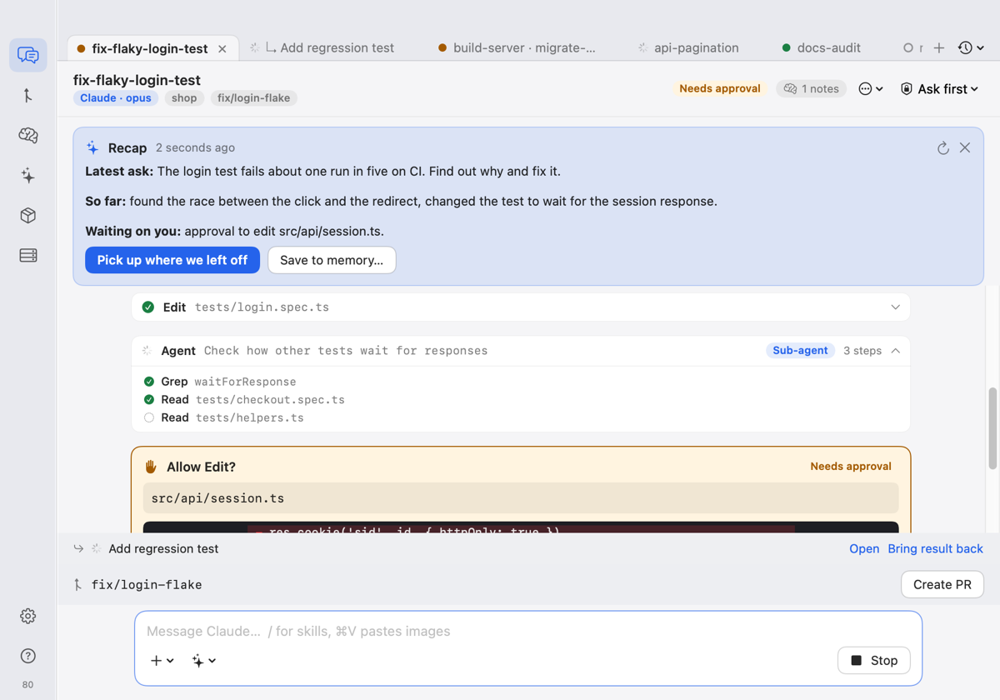
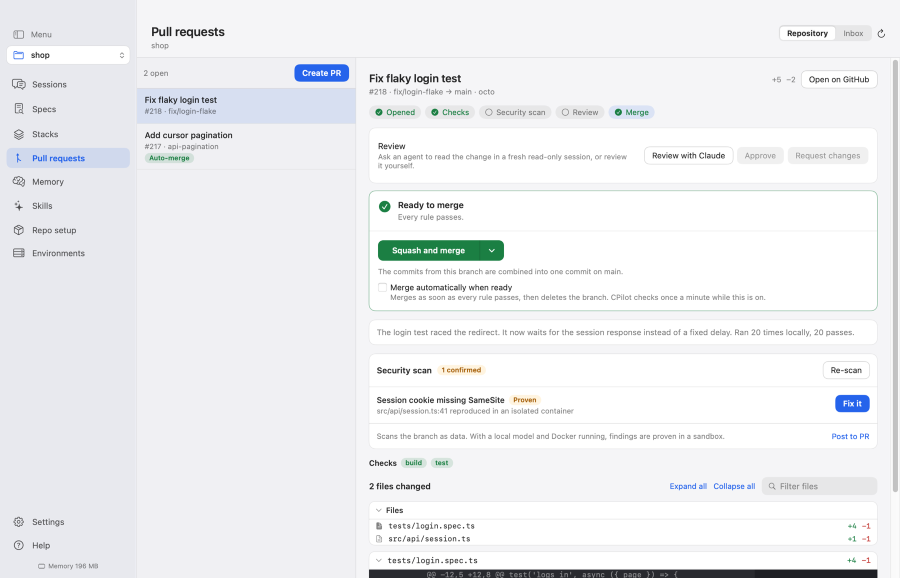
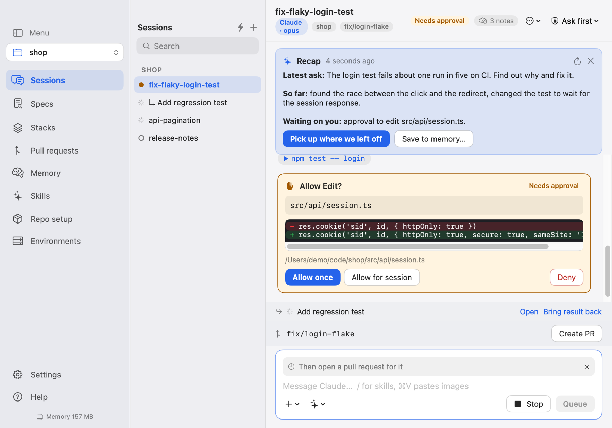

# CPilot

A superlight native macOS app for running AI coding sessions from your menu bar. Tabs for many sessions, one calm chat, approvals you control, and pull requests from branch to merge.

<p align="center"></p>

## Install with an AI agent

Paste this into an AI coding agent such as Claude Code. CPilot detects and installs its own prerequisites on first launch, so the agent does not have to:

```text
Install CPilot on this Mac.
1. Run: curl -fsSL https://raw.githubusercontent.com/kalahroudi/cpilot/main/scripts/install.sh | bash
2. CPilot opens and its first-run setup checks what it needs and installs whatever is missing. Tell me to click
   "Set everything up" in that window if it is waiting, and wait until it reports everything is ready.
   If a step needs my password, tell me exactly which command to run in Terminal.
3. Register its MCP server: claude mcp add cpilot --scope user -- /Applications/CPilot.app/Contents/MacOS/cpilot-mcp
4. Call get_status and tell me what it reports.
Never call a destructive tool without asking me first.
```

Or by hand: download the latest disk image from [Releases](https://github.com/kalahroudi/cpilot/releases), or run the install script above.

## What it does

- **Many sessions, one pane.** Sessions are tabs (or a side list grouped by project). Only the open tab has a live view; idle tabs stop their agent and resume later with full context.
- **Claude and other agents.** Claude runs through its headless command line. Any agent that speaks the [Agent Client Protocol](https://agentclientprotocol.com) can be added from the official registry in one click.
- **Access you control.** Read only, Ask first, Edit files or Full access, with per-project rules. Every action that needs approval shows a card: allow once, for the session, or always in this project. Full access needs Touch ID. Every decision is logged.
- **Nothing lost on a crash.** Messages are written to disk as they complete, streaming replies are checkpointed, drafts are saved as you type, and sessions resume by id with the agent's own context.
- **Capture.** Press Control-Option-Command-C to grab part of the screen, or add selected text, the front browser page or the clipboard. It lands in the active session's composer.
- **Pull requests, end to end.** Create, read the diff, review with an agent, run a security scan, and merge automatically when your rules pass. Everything goes through your own GitHub login.
- **Repo setup in one go.** README, license, GitHub Pages, a protected main branch and a scan on every pull request.
- **Memory that recalls.** Plain Markdown notes every session starts with, plus a local index (full-text and on-device meaning search, one SQLite file) of your finished messages. A new session starts with the best matches from earlier work. Fork a session or hand it to another agent with a summary, save what a session learned as a note in one click, and see exactly which notes a session loaded. An optional long-term memory engine can also connect over MCP.
- **Skills.** Skills found on your Mac are listed and one click away in the composer.
- **MCP built in.** Other tools can list sessions, read results, search memory and start sessions (you approve each one).
- **Self-updating.** Checks GitHub Releases once a day and rolls back by itself if a new version fails to start.

<p align="center">
  
  
</p>

## Requirements

macOS 15 or later on Apple silicon. First launch checks for Git and the Claude command line and offers to install the optional GitHub command line and Node.js.

## Build from source

```sh
swift build && swift test
scripts/bundle.sh                         # builds dist/CPilot.app
dist/CPilot.app/Contents/MacOS/CPilot --self-test
```

The core lives in `Sources/CPilotKit` (no UI, unit tested), the app in `Sources/CPilot`, and the MCP server in `Sources/cpilot-mcp`. One dependency, used only to render Markdown and highlight code in the chat. Set `CPILOT_LIVE=1` to also run the test that talks to the real Claude command line.

## Where your data lives

Everything CPilot owns is under `~/Library/Application Support/CPilot/`: sessions, notes, the recall index (`memory.db`), the approval log and settings. Nothing is sent anywhere; secrets such as API keys are removed before text is indexed. Delete that folder to uninstall completely.

## License

Apache License 2.0
